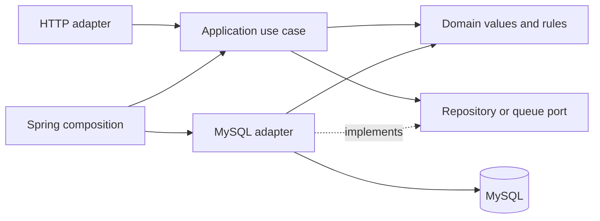

# AdInsight backend architecture

Product authority: [spec-v1.md](../spec-v1.md). The user requested DDD, SOLID and
clean code on 2026-10-15; this document records the concrete dependency rules.

The root Maven POM aggregates `backend/`. Each context lives under
`backend/src/main/java/io/datavortex/adinsight/` and groups its own layers:

```text
backend/
  pom.xml
  src/main/java/io/datavortex/adinsight/
    identityaccess/   domain/model/ application/port/ infrastructure/ interfaces/http/
    advertising/      domain/model/ application/ infrastructure/ interfaces/http/
    ingestion/        domain/model/ application/ infrastructure/ interfaces/http/
    shared/           domain/ interfaces/http/
  src/main/resources/db/migration/
  src/test/java/io/datavortex/adinsight/
```

## Where services, entities, DTOs and controllers live

Each context owns its own folders rather than sharing one global controller or
service folder. For example, the advertising context contains:

```text
advertising/
  domain/model/
    AdAccount.java                 # Framework-free account model
    SourcePlatform.java
  application/
    service/AccountQueryService.java  # Coordinates the account query
    port/AccountCatalog.java          # Required persistence capability
  infrastructure/
    config/AdvertisingConfiguration.java  # Spring bean composition
    persistence/
      AdAccountEntity.java            # JPA representation of the database row
      SpringDataAccountRepository.java
      JpaAccountCatalog.java          # Implements AccountCatalog
  interfaces/http/
    controller/AccountController.java
    dto/AccountResponse.java
    dto/AccountListResponse.java
    mapper/AccountResponseMapper.java
```

The request flows through `AccountController` → `AccountQueryService` →
`AccountCatalog`. Spring injects `JpaAccountCatalog` as the implementation.
The persistence adapter converts `AdAccountEntity` into `AdAccount`; the HTTP
mapper converts that domain model into `AccountResponse` for serialization.
The controller handles HTTP input/output, while the service coordinates the use
case. Repository ports describe capabilities without importing Spring or JPA.

Ingestion follows the same structure: `IngestionJobController`,
`IngestionJobService`, `CreateIngestionJobRequest`, `IngestionJobResponse` and
`IngestionJobResponseMapper`. Identity/access has a separate `CsrfTokenResponse`
DTO and `infrastructure/config/SecurityConfiguration`.

DTOs use top-level Java records in separate files. Records express immutable
data carriers; they do not imply a layer. Domain records live in `domain/model`,
HTTP records in `interfaces/http/dto`, and JPA entities in infrastructure.
Ingestion currently uses JDBC, so it has a row mapper rather than an artificial
JPA entity. Likewise, no domain service or interface/implementation pair is
added unless behavior requires it. Pure HTTP mappers have no servlet dependency.

## Context ownership

- `identityaccess`: user authentication, active tenant membership and role
  capabilities. Spring Security/HTTP/JDBC are adapters; `TenantScope` and
  `TenantRole` remain plain Java.
- `advertising`: canonical ad-account metadata. `AccountCatalog` is a read
  port consumed by account queries and ingestion; its JPA adapter maps a
  persistence entity to a framework-free `AdAccount`. Credentials stay outside
  this interface and HTTP DTOs.
- `ingestion`: immutable request/date values, job identity/status, sequence,
  retry limit and lease generation. Use cases enforce tenant roles and account
  ownership. Repository/queue ports hide atomic MySQL idempotency and claiming.
- `shared`: safe domain errors and HTTP error/correlation adapters. Keep shared
  business vocabulary small; context-specific models stay with their owner.

The glossary is [CONTEXT.md](../CONTEXT.md). Context dependencies are acyclic:
ingestion consumes advertising and identity/access contracts; adapters perform
mapping. Persistence is MySQL metadata, GCS raw, BigQuery analytics and a
rebuildable Elasticsearch projection, following the spec.



## Enforced dependency direction

1. Domain depends only on the JDK and domain types.
2. Application depends only on the JDK, domain and application ports.
3. HTTP adapters use application interfaces and domain values; they do not
   depend on infrastructure, JPA, Spring Data or JDBC.
4. Infrastructure implements outbound ports and supplies Spring composition.
   This composition may refer to inbound HTTP filters for security wiring.
5. Contexts have no dependency cycles.

`backend/src/test/.../architecture/ArchitectureTest.java` checks these rules with
ArchUnit in the existing Maven test command. Isolated test fixtures prove that
plain Java passes while JPA in domain and JDBC in application fail for the
intended rule. This is local validation; CI/merge protection is not configured.
Reference: [ArchUnit importer/rules](https://www.archunit.org/userguide/html/000_Index.html).

Java formatting is pinned with Spotless and Google Java Format (AOSP style).
`rtk proxy ./mvnw.cmd -pl backend spotless:apply` applies it; normal Maven
validation checks it. Formatting and architecture checks share the regular build.

The design uses constructor injection and ports/adapters (dependency inversion),
separate command/query use cases, repository interfaces and explicit persistence
mapping. Value objects validate their own dates/identities. No generic base
repository/controller or empty service hierarchy is introduced.

## Implemented ingestion queue and limits

`POST /api/v1/ingestion-jobs` accepts a tenant-admin request with an
`Idempotency-Key`. Reusing a key with the same scope returns the durable job;
reusing it with different scope returns 409. Keys are case-sensitive per tenant.
Sequence allocation and deduplication share one transaction. The MVP serializes
submission within a tenant to avoid a duplicate-key race; this is a deliberate
throughput tradeoff, not a claim of high-scale ingestion.

`FetchJobQueue` only claims FETCH-stage jobs. It uses database UTC time,
`FOR UPDATE SKIP LOCKED`, an unguessable lease token and increasing generation.
Renew/retry/fail require an unexpired matching lease. Crash reclaim keeps the
attempt and deterministic external job identity; an explicit transient failure
defers a new attempt (up to five retries). Caller-supplied delay can honor a
source's Retry-After. Permanent failure is explicit; dependency messages are
not persisted as error codes.

HTTP Basic credentials are revalidated per request; authentication is stored
only in request attributes, not reused from an HTTP session. A separate session
cookie stores CSRF state for browser mutations. Explicit authentication-strategy
configuration avoids treating each Basic request as a new session login and
clearing its CSRF token. The integration test submits twice with the same token
and cookie, and separately rejects a request without CSRF proof.

There is no scheduler or source handler wired yet: jobs remain PENDING until a
worker consumes the queue. Claiming does not fetch data or publish anything.
The fetch lease is not a warehouse publisher fence. GCS/BigQuery adapters,
persisted remote job reconciliation, the single publisher lock and
publish/checkpoint completion remain pending. The queue has no operation that
can mark a job SUCCEEDED or advance a watermark without that future protocol.

`pipeline/` remains the raw/Parquet tooling and SQLite test oracle, independent
of backend persistence. `warehouse/bigquery/` contains prepared cloud SQL assets.
Search, UI, reports, forecast, bidding and cloud deployment remain pending.
