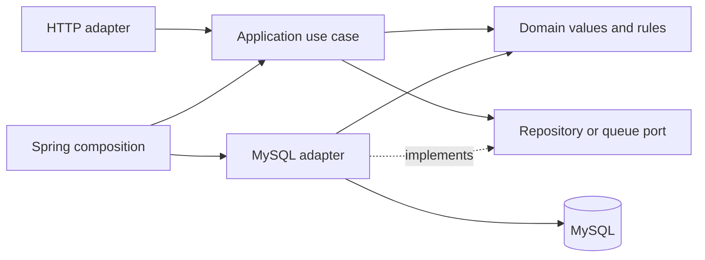

# AdInsight backend architecture

```text
backend/
  pom.xml
  src/main/java/io/datavortex/adinsight/
    identityaccess/   domain/model/ application/port/ infrastructure/ interfaces/http/
    advertising/      domain/model/ application/ infrastructure/ interfaces/http/
    ingestion/        domain/model/ application/ infrastructure/ interfaces/http/
    shared/           domain/ interfaces/http/
  src/main/resources/db/migration/
  src/test/java/io/datavortex/adinsight/
```

## Where services, entities, DTOs and controllers live

Each context owns its own folders rather than sharing one global controller or
service folder. For example, the advertising context contains:

```text
advertising/
  domain/model/
    AdAccount.java                 # Framework-free account model
    SourcePlatform.java
  application/
    service/AccountQueryService.java  # Coordinates the account query
    port/IAccountCatalog.java         # Required persistence capability
  infrastructure/
    config/AdvertisingConfiguration.java  # Spring bean composition
    persistence/
      AdAccountEntity.java            # JPA representation of the database row
      SpringDataAccountRepository.java
      JpaAccountCatalog.java          # Implements IAccountCatalog
  interfaces/http/
    controller/AccountController.java
    dto/AccountResponse.java
    dto/AccountListResponse.java
    mapper/AccountResponseMapper.java
```

The request flows through `AccountController` → `AccountQueryService` →
`IAccountCatalog`. Spring injects `JpaAccountCatalog` as the implementation.
The persistence adapter converts `AdAccountEntity` into `AdAccount`; the HTTP
mapper converts that domain model into `AccountResponse` for serialization.
The controller handles HTTP input/output, while the service coordinates the use
case. Repository ports describe capabilities without importing Spring or JPA.

Ingestion follows the same structure: `IngestionJobController`,
`IngestionJobService`, `CreateIngestionJobRequest`, `IngestionJobResponse` and
`IngestionJobResponseMapper`. Identity/access has a separate `CsrfTokenResponse`
DTO and `infrastructure/config/SecurityConfiguration`.

DTOs use top-level Java records in separate files. Records express immutable
data carriers; they do not imply a layer. Domain records live in `domain/model`,
HTTP records in `interfaces/http/dto`, and JPA entities in infrastructure.
Ingestion currently uses JDBC, so it has a row mapper rather than an artificial
JPA entity. Likewise, no domain service or interface/implementation pair is
added unless behavior requires it. Pure HTTP mappers have no servlet dependency.

## Context ownership

- `identityaccess`: user authentication, active tenant membership and role
  capabilities. Spring Security/HTTP/JDBC are adapters; `TenantScope` and
  `TenantRole` remain plain Java.
- `advertising`: canonical ad-account metadata. `IAccountCatalog` is a read
  port consumed by account queries and ingestion; its JPA adapter maps a
  persistence entity to a framework-free `AdAccount`. Credentials stay outside
  this interface and HTTP DTOs.
- `ingestion`: immutable request/date values, job identity/status, sequence,
  retry limit and lease generation. Use cases enforce tenant roles and account
  ownership. Repository/queue ports hide atomic MySQL idempotency and claiming.
- `shared`: safe domain errors and HTTP error/correlation adapters. Keep shared
  business vocabulary small; context-specific models stay with their owner.

The glossary is [CONTEXT.md](../CONTEXT.md). Context dependencies are acyclic:
ingestion consumes advertising and identity/access contracts; adapters perform
mapping. Persistence is MySQL metadata, GCS raw, BigQuery analytics and a
rebuildable Elasticsearch projection, following the spec.



## Enforced dependency direction

1. Domain depends only on the JDK and domain types.
2. Application depends only on the JDK, domain and application ports.
3. HTTP adapters use application interfaces and domain values; they do not
   depend on infrastructure, JPA, Spring Data or JDBC.
4. Infrastructure implements outbound ports and supplies Spring composition.
   This composition may refer to inbound HTTP filters for security wiring.
5. Contexts have no dependency cycles.

`backend/src/test/.../architecture/ArchitectureTest.java` checks these rules with
ArchUnit in the existing Maven test command. Isolated test fixtures prove that
plain Java passes while JPA in domain and JDBC in application fail for the
intended rule. This is local validation; CI/merge protection is not configured.
Reference: [ArchUnit importer/rules](https://www.archunit.org/userguide/html/000_Index.html).

Java formatting is pinned with Spotless and Google Java Format (AOSP style).
`rtk proxy ./mvnw.cmd -pl backend spotless:apply` applies it; normal Maven
validation checks it. Formatting and architecture checks share the regular build.

The design uses constructor injection and ports/adapters (dependency inversion),
separate command/query use cases, repository interfaces and explicit persistence
mapping. Value objects validate their own dates/identities. No generic base
repository/controller or empty service hierarchy is introduced.

## Implemented ingestion queue and limits

`POST /api/v1/ingestion-jobs` accepts a tenant-admin request with an
`Idempotency-Key`. Reusing a key with the same scope returns the durable job;
reusing it with different scope returns 409. Keys are case-sensitive per tenant.
Sequence allocation and deduplication share one transaction. The MVP serializes
submission within a tenant to avoid a duplicate-key race; this is a deliberate
throughput tradeoff, not a claim of high-scale ingestion.

`FetchJobQueue` claims local FETCH/RAW_COMPLETE/NORMALIZE-stage jobs. It uses database UTC time,
`FOR UPDATE SKIP LOCKED`, an unguessable lease token and increasing generation.
Renew/retry/fail require an unexpired matching lease. Crash reclaim keeps the
attempt and deterministic external job identity; an explicit transient failure
defers a new attempt (up to five retries). Caller-supplied delay can honor a
source's Retry-After. Permanent failure is explicit; dependency messages are
not persisted as error codes.

Default authentication is a Keycloak/OIDC resource server. Exact `(issuer, sub)`
identity links resolve ACTIVE local users; current MySQL membership supplies
tenant scope and roles. Signature, issuer, audience and token time claims are
validated before metadata access. JWT roles/tenant/email cannot grant access.
Bearer mode is stateless. Required configuration, provisioning, local Keycloak,
revocation limits and proof are in [backend-foundation.md](backend-foundation.md)
and [ADR 0002](decisions/0002-oidc-and-backend-foundation.md).

The explicit `local` profile retains HTTP Basic/BCrypt compatibility.
Basic credentials are revalidated per request; authentication is stored
only in request attributes, not reused from an HTTP session. A separate session
cookie stores CSRF state for browser mutations. Explicit authentication-strategy
configuration avoids treating each Basic request as a new session login and
clearing its CSRF token. The integration test submits twice with the same token
and cookie, and separately rejects a request without CSRF proof.

`LocalIngestionWorker` coordinates the local slice through `LocalIngestionPipeline`.
The opt-in `LocalWorkerConfiguration` schedules one polling job at a time.
`PythonIngestionPipeline` is an outbound adapter: it reads scoped MySQL account
and campaign metadata, creates a credential-free request file and runs the existing
Python pipeline with a bounded subprocess lifetime. Its wait loop renews the
lease; loss of ownership cancels the subprocess. Domain/application layers remain
plain Java. Source I/O and raw/Parquet encoding stay together in Python rather
than introducing a second normalization implementation in Java.

Complete raw transitions through RAW_COMPLETE to NORMALIZE. Valid Parquet parks
the job at RUNNING/LOAD and releases the local lease. V3 adds its normalized
manifest pointer. Artifact pointers/counters and stage transitions are fenced by
the same database token/generation/expiry predicate. Crash reclaim at any local
stage restarts FETCH in a fresh raw directory; previous artifacts remain intact.
The local lease is not a warehouse publisher fence. A separate `WarehouseWorker`
coordinates the cloud stages through `WarehouseQueue` and `WarehouseGateway` ports.
`MySqlWarehouseQueue` owns tenant-bound V4 execution state and a global publisher
slot. It locks the slot before selecting a job; expiry reassigns ownership of the
same job, never another scope with an unknown remote outcome. Token/generation and
database expiry fence every mutation. A dedicated heartbeat supports blocking SDK
calls. Persisted plan/command data pins run, target, compiled SQL, byte cap and
deterministic remote identity across crash and configuration changes.

`GcsSnapshotStore` verifies local proof and uploads with create-only generation and
CRC32C preconditions. Existing identical objects are resumable; conflicts fail.
`DataformCompiler` compiles a pinned source revision and retrieves quality/publish
operations. `BigQueryWarehouseGateway` submits those compiled operations under
persisted IDs and typed parameters, checks request fingerprints on reconciliation,
and distinguishes missing/running/success/terminal failure from dependency ambiguity.
It never generates a fresh remote ID merely because the response was lost.

The cloud worker advances LOAD → MANIFEST (public stage LOAD) → TRANSFORM → PUBLISH
→ CHECKPOINT. A successful remote publish permits the atomic MySQL transaction
that writes checkpoint/watermark and SUCCEEDED; a crash resumes from the persisted
stage rather than loading/publishing blindly. The cloud composition is opt-in and
its real service execution remains unverified until the explicit cloud proof passes.
See [local ingestion](local-ingestion.md) and [warehouse cloud](warehouse-cloud.md).

`pipeline/` owns raw/Parquet encoding and validated SQLite dev publication. The
owner-approved `dev-warehouse` profile exposes it through the analytics port;
BigQuery remains the cloud warehouse. See [local-backend.md](local-backend.md)
and [ADR 0003](decisions/0003-local-warehouse-and-budget-policy.md).
`warehouse/bigquery/` contains the cloud SQL assets.
Search, UI, reports, forecast, bidding and cloud deployment remain pending.

## Schema and behavior coverage

The architecture accommodates further modules, but schema presence does not
mean a complete domain model, use case or HTTP contract exists. Against spec
section 7, coverage after the metadata/budget/dev analytics slice is:

| Schema area | Migration | Implemented behavior and remaining gap |
| --- | --- | --- |
| tenants, users, memberships | V1 | Active identity/tenant/membership checks; administration APIs remain absent |
| user_identities (owner-approved extension) | V5 | Exact Keycloak identity links and active local user lookup; privileged manual provisioning |
| ad_accounts | V1 | Credential-free bounded reads and audited admin creation; connection-test remains absent |
| campaigns | V1 | Member detail and versioned admin local-settings with atomic full projection/audit; source metadata import remains incomplete |
| ad_groups, keywords | V1 | Tenant-parent constraints and member keyword detail hiding deleted parents; metadata import/search remain absent |
| ingestion_jobs, ingestion_checkpoints, publication_watermarks | V1–V4 | Durable queue, local campaign ingestion, cloud reconciliation/publication code; live cloud proof and keyword ingestion remain pending |
| outbox_events | V1 | Immutable full campaign projection written atomically with local settings/version; Elasticsearch consumer pending |
| audit_logs | V1 | Atomic account/local-settings/budget audits; platform administration/bidding audit behavior pending |
| budget_plans, kpi_targets | V6 | Admin save/member read, revision CAS, serialized nonoverlapping active periods, exact account currency/DECIMAL policy and atomic KPI replacement |
| report_jobs | Absent | Snapshot/export/download authorization and retention pending |
| forecast_runs, alerts | Absent | Forecast orchestration/results, dedupe and acknowledgement pending |
| bid_proposals | Absent | Approval, stale-version checks, simulator execution and audit pending |

Account create/list, campaign/keyword detail, local settings, budgets/KPI,
local analytics summary/daily, ingestion submit/status and local-profile CSRF are
HTTP use cases today. Platform-admin operations are not implemented. The four
missing business tables must be introduced with their owning behavior and proof,
rather than empty entity/repository classes that suggest functionality exists.

The budgeting context owns the accepted KPI whitelist, positive DECIMAL(20,6)
targets and revision semantics. Its JDBC adapter locks the owning campaign before
checking active overlap, including first-plan creation; simultaneous inserts
therefore cannot both pass an empty overlap query. KPI rows and audit share the
same transaction. Metadata patches distinguish omission from explicit clearing,
check version before no-op detection, and retain immutable versioned outbox payloads.

Analytics application/domain remain plain Java. Its MySQL scope adapter resolves
active campaigns within verified tenant/account/currency scope; the outbound
Python adapter reads one SQLite facts/watermark transaction using exact Decimal
sums and ratios, then maps decimal strings to the HTTP contract. An unavailable
warehouse returns 503; it cannot create a database or silently return empty data.
The explicit development profile does not select Basic authentication. Local
publication is currently a CLI step; it does not complete cloud ingestion jobs
or write MySQL cloud checkpoints. Cloud analytics reads, automatic local completion,
reporting and forecasts remain pending; BigQuery publication code is preserved.

Account pagination is a framework-free `PageQuery`/`AccountPage` interface. Its
JPA adapter uses an ID-sorted, tenant-filtered `Slice` (size+1); HTTP returns page,
size and hasMore without an unbounded query or COUNT. Offset pages are live
reads. Search retains the separate PIT/cursor contract in spec section 9.4.

Shared HTTP adapters return safe, correlated JSON for domain, validation,
framework and unexpected errors, preserving status/protocol headers. Authentication
and membership dependency failures fail closed with 503. JSON request logs carry
verified tenant/user context; full worker metrics and production deployment
observability remain pending. Existing ArchUnit rules continue to enforce the
inward dependency direction through the normal Maven command.
