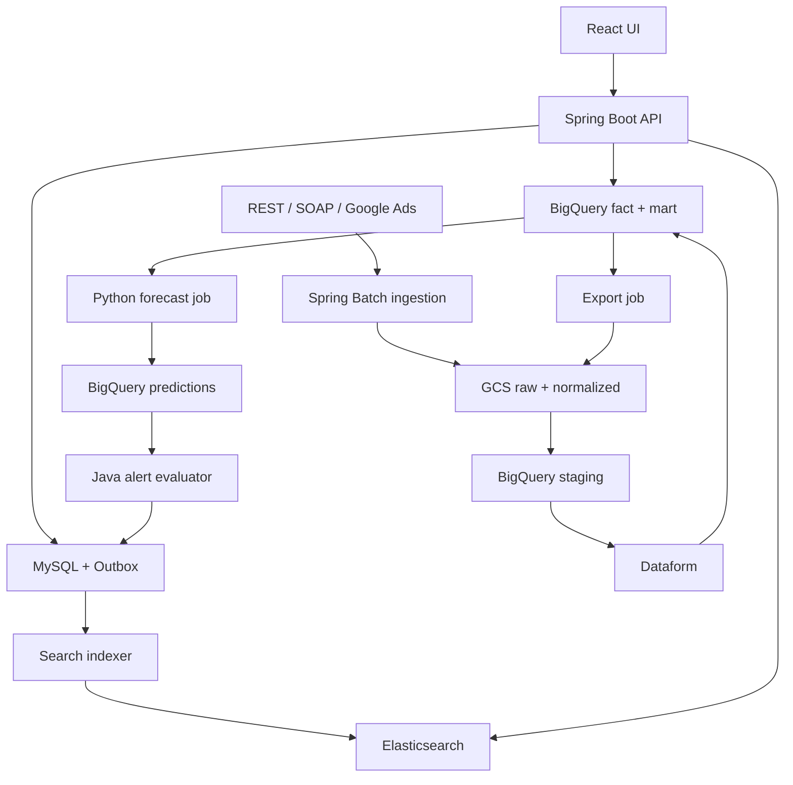
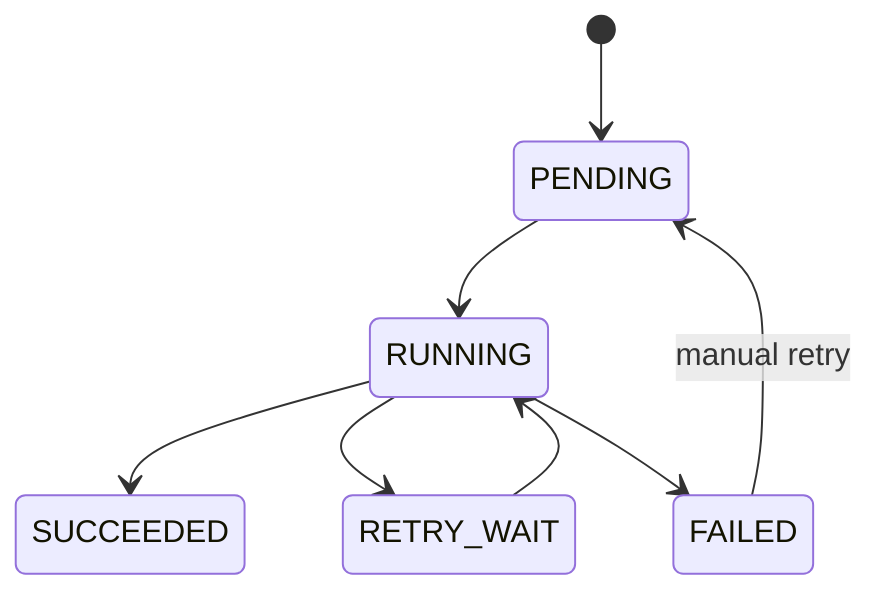

# AdInsight — Đặc tả triển khai v1.0

Ngày: 14/10/2026. Ngôn ngữ: tiếng Việt. Đối tượng: sinh viên đã có nền tảng Java/Spring/SQL, đang triển khai Data Warehouse.

Tên đề tài: **Xây dựng nền tảng tích hợp dữ liệu quảng cáo đa kênh, tìm kiếm campaign/keyword, báo cáo tự động và dự báo KPI bằng Java, Elasticsearch và Google BigQuery.**

Tài liệu này là thiết kế đề xuất để bắt đầu lập trình, chưa phải phần mềm đã triển khai hay kết quả benchmark. Mọi mục tiêu hiệu năng cần đo trên cấu hình thực tế. Phạm vi mặc định: một người hoặc nhóm nhỏ, 10–12 tuần từ giai đoạn Data Warehouse. Ưu tiên tích hợp vào backend hiện có; không viết lại phần đăng nhập/CRUD đã hoạt động.

## 1. Mục tiêu và phạm vi

### 1.1 Kết quả cuối cùng

1. Quản lý nhiều advertiser, tài khoản quảng cáo, campaign, ad group, keyword, ngân sách và KPI.
2. Tải báo cáo theo giờ/ngày từ nguồn REST, SOAP; chuẩn hóa và lưu dữ liệu thô có thể replay.
3. Data Warehouse BigQuery có staging, fact, mart; dữ liệu đến muộn được cập nhật đúng.
4. Elasticsearch tìm kiếm campaign/keyword: full-text, autocomplete, lọc và phân trang sâu.
5. Dashboard có số liệu nhất quán với CSV/Excel cho cùng dữ liệu đầu vào.
6. Xuất báo cáo bất đồng bộ, tải file sau khi job hoàn thành.
7. Dự báo cuối kỳ, đánh giá baseline và cảnh báo nguy cơ không đạt KPI.
8. Đề xuất bid, phê duyệt và thực thi trong simulator, có audit log.
9. Có kiểm thử phục hồi và benchmark để đưa vào luận văn.

### 1.2 MVP và mở rộng

| MVP bắt buộc | Mở rộng sau MVP |
|---|---|
| Một backend chia module, một worker | Nhiều worker theo tải |
| REST mock + SOAP mock | Google Ads connector khi đủ quyền; thêm nguồn khác |
| MySQL, GCS, BigQuery, Elasticsearch | SQL Server adapter, GKE |
| Campaign/keyword search | Phân tích log bằng Elastic Stack |
| CSV, Excel, dashboard | Tableau nếu có giấy phép |
| Ba baseline dự báo | Mô hình ML nâng cao |
| Bidding simulator | Adapter thay đổi bid trên test account nếu chiến lược hỗ trợ |
| 1M dòng fact, 100K search document | 10M dòng fact, 1M document, 5.000 report jobs/ngày |

Không lấy việc có tài khoản quảng cáo production hoặc tạo 3TB dữ liệu làm điều kiện hoàn thành. Không xây Real-Time Bidding exchange. Không thực hiện chi tiêu quảng cáo thật trong MVP.

## 2. Các quyết định kiến trúc

| Quyết định | Lựa chọn và lý do |
|---|---|
| Kiểu ứng dụng | Modular monolith: dễ triển khai, kiểm thử và bảo vệ |
| Nguồn chuẩn metadata/nghiệp vụ | MySQL |
| Dữ liệu phân tích chuẩn | BigQuery fact/mart; lưu dữ liệu gốc trong GCS |
| Vai trò Elasticsearch | Projection tìm kiếm metadata, có thể dựng lại từ MySQL |
| Đồng bộ search | Transactional outbox, full-document upsert và version |
| Truy vấn báo cáo | BigQuery mart; không tính tiền hoặc KPI từ Elasticsearch |
| Triển khai batch | Cloud Run Jobs; local là process worker riêng |
| Event delivery | At-least-once; consumer/job phải idempotent |
| Transform | Dataform SQLX + BigQuery SQL; không kéo toàn bộ fact về Java |
| Forecast | Python batch job, lưu kết quả; Java chạy rule cảnh báo |

Elasticsearch không lưu toàn bộ lịch sử performance 3TB. V1 chỉ index metadata campaign/keyword. Không đưa KPI thay đổi theo kỳ vào document search vì dễ gây lệch số liệu và tăng chi phí cập nhật. Nếu sau này cần lọc keyword theo CPA, triển khai một projection metric có cửa sổ và watermark riêng, không trộn với v1.

## 3. Tech stack

| Nhóm | Công nghệ |
|---|---|
| Backend | Java 21, Spring Boot, Spring MVC, Spring Security, Maven |
| Persistence | Spring Data JPA cho metadata; JDBC cho bulk metadata khi cần; Flyway |
| Batch | Spring Batch, Resilience4j cho API call |
| Connector | RestClient, Google Ads Java Client, Apache CXF/JAX-WS cho SOAP |
| MySQL | MySQL 8.4 LTS; Cloud SQL for MySQL cho bản cloud nếu phù hợp ngân sách |
| Search | Elasticsearch + official Elasticsearch Java API Client; Kibana cho phát triển |
| Warehouse | BigQuery, Dataform, Google Cloud Java SDK |
| File | GCS; JSONL gzip cho raw; Parquet cho normalized batch |
| Async | Pub/Sub cloud; local dùng bảng job và worker polling |
| Export | Apache Commons CSV, Apache POI SXSSF |
| UI | React, TypeScript, Vite, Ant Design, ECharts |
| BI | Looker Studio đọc dataset mart; MVP chỉ dùng dữ liệu demo và quyền phù hợp |
| Forecast | Python, pandas, numpy, scikit-learn; baseline cũng có thể viết bằng pandas |
| Ops | Docker Compose, Cloud Run, Cloud Run Jobs, Artifact Registry, Secret Manager |
| Test | JUnit 5, Testcontainers, WireMock; k6 cho HTTP benchmark |
| CI/CD | GitHub Actions, Cloud Logging, Spring Boot Actuator |

**Quy tắc version:** giữ Spring Boot hiện có nếu đang được hỗ trợ và phù hợp. Pin patch version trong pom/lockfile và Docker image, không dùng tag `latest`. Elasticsearch server, Kibana và Java client dùng bản tương thích đã kiểm tra; server/client cùng major và ưu tiên cùng minor. Nếu chọn Spring Data Elasticsearch phải tuân theo compatibility matrix của Spring; v1 dùng official client trực tiếp để kiểm soát mapping, Bulk và PIT. Xác nhận dependency tree và integration smoke test trước khi khóa bản phát hành. Tài liệu Elastic tại mục 24.

## 4. Kiến trúc và luồng dữ liệu



Lập lịch cloud: Cloud Scheduler kích hoạt ingestion job; job điều phối load và Dataform theo thứ tự, chờ trạng thái thực sự thành công. Không giả định gọi API chạy transform đồng nghĩa transform đã hoàn thành.

Pub/Sub dùng cho thông báo công việc/report/forecast ready. Payload chỉ chứa ID và metadata nhỏ, không chứa file quảng cáo. Local có cùng handler nhưng nhận job qua MySQL polling; không yêu cầu chạy queue emulator để có MVP.

## 5. Người dùng và phân quyền

`tenant_id` đại diện advertiser trong v1. Tài khoản quảng cáo thuộc đúng một tenant. User có thể là thành viên nhiều tenant thông qua membership.

| Vai trò | Quyền |
|---|---|
| PLATFORM_ADMIN | Quản lý tenant và vận hành toàn hệ thống; hành động cross-tenant được audit |
| TENANT_ADMIN | Quản lý account, campaign, budget, KPI, membership trong tenant |
| ANALYST | Xem dữ liệu, tạo report, xem forecast/alert, tạo đề xuất bid |
| VIEWER | Xem dashboard/search, tải report được cấp quyền |

Mỗi request dùng `X-Tenant-Id` để chọn tenant; backend kiểm tra membership từ principal trước khi truy cập. Không tin tenant trong request body. Mọi MySQL query, BigQuery query, search/filter/aggregation Elasticsearch và download phải cùng scope đã xác thực. Tenant admin mới được approve bid. Không trả 200 nếu dữ liệu phụ thuộc đang lỗi; phân biệt không có dữ liệu với dependency unavailable.

Các ID dùng UUID string 36 ký tự trong MySQL v1; source ID là string để không mất định dạng. `source_platform` là enum `MOCK_REST`, `MOCK_SOAP`, `GOOGLE_ADS`.

V1 chưa hỗ trợ xóa campaign cùng toàn bộ keyword qua API. Khi nguồn đánh dấu campaign bị xóa, import phải soft-delete campaign và các ad group/keyword liên quan, tăng từng search_version và tạo outbox theo batch; cho đến khi hoàn tất, detail và search result cần loại parent đã bị xóa. Không để keyword mồ côi còn truy cập được. Với bulk import lớn, đặt trạng thái DELETING và job theo dõi tiến độ thay vì một transaction khổng lồ.

## 6. Nghiệp vụ và quy tắc dữ liệu

### 6.1 Chỉ số

| Chỉ số | Công thức | Khi mẫu số bằng 0 |
|---|---|---|
| CTR | SUM(clicks) / SUM(impressions) | null |
| CPC | SUM(cost) / SUM(clicks) | null |
| CPA | SUM(cost) / SUM(conversions) | null |
| ROAS | SUM(conversion_value) / SUM(cost) | null |
| CVR | SUM(conversions) / SUM(clicks) | null |

API trả tỷ lệ thập phân; UI nhân 100 khi hiển thị phần trăm. Không trung bình cộng CTR/CPC/CPA theo từng dòng. Decimal trả JSON string để UI không làm mất precision. `conversions` là NUMERIC vì nguồn có thể trả conversion phân bổ dạng thập phân.

V1 không quy đổi tiền tệ: lọc theo currency hoặc trả các nhóm currency riêng. Budget/cost/forecast phải cùng currency. Không cộng conversion từ các nền tảng để gọi là số khách hàng duy nhất; đây là platform-attributed conversions, có thể trùng attribution.

### 6.2 Thời gian và độ mới

- `report_date` là ngày theo timezone của account, không phải ngày UTC tải file.
- `fetched_at`, job timestamp và audit timestamp dùng UTC.
- Lập lịch mỗi giờ là **tải lại daily snapshot của ngày hiện tại** trong v1; không khẳng định có fact hourly.
- Mỗi ngày reload cửa sổ mặc định 7 ngày; cấu hình riêng cho từng nguồn. Có backfill theo khoảng ngày.
- Dashboard trả `dataAsOf` (UTC), `reportTimezone`, `isPartial` và trạng thái cập nhật.
- KPI kỳ đang chạy có thể thay đổi do conversion cập nhật muộn; forecast phải dùng watermark đã công bố.
- Source mock hỗ trợ simulate late correction, zero rows, rate limit, timeout và partial pagination.

### 6.3 Quyền sở hữu campaign

Account/campaign/keyword từ nguồn được import/upsert bằng source key. Tên/status tại nguồn là dữ liệu nguồn chuẩn; trường local note/tag/budget plan/KPI do ứng dụng quản lý. Không ghi đè local note/tag khi sync. Campaign tạo local thuộc simulator; thay đổi campaign thật phải qua connector và audit. Cấu trúc tên canonical cho search lấy từ bản metadata đã đồng bộ gần nhất.

## 7. Schema MySQL

Tất cả bảng tenant-owned có `tenant_id NOT NULL`, `created_at`, `updated_at` UTC. Bảng metadata searchable có `search_version BIGINT NOT NULL DEFAULT 1` tăng đơn điệu ở mỗi lần thay đổi projection. Soft-delete với `is_deleted` và `deleted_at`; không tái sử dụng UUID. FK tenant-owned sử dụng composite `(tenant_id,id)` đến parent tương ứng để ngăn gắn nhầm tenant.

Các bảng làm parent có UNIQUE(tenant_id,id) để hỗ trợ composite FK. Validation service bổ sung quan hệ account/campaign/ad group; không chỉ kiểm tra ID tồn tại. Event ID là UUID, không dùng ID tăng dần làm commit watermark.

| Bảng | Các cột chính | Ràng buộc/index |
|---|---|---|
| tenants | id, name, status | PK id |
| users | id, email, password_hash, status | UNIQUE email |
| memberships | tenant_id, user_id, role | PK(tenant_id,user_id) |
| ad_accounts | id, tenant_id, platform, source_account_id, currency, timezone, credential_ref, status | UNIQUE(tenant_id,platform,source_account_id) |
| campaigns | id, tenant_id, account_id, source_campaign_id, name, source_status, local_tags JSON, start_date, end_date, search_version, is_deleted | UNIQUE(tenant_id,account_id,source_campaign_id); INDEX(tenant_id,updated_at,id) |
| ad_groups | id, tenant_id, campaign_id, source_ad_group_id, name, status | UNIQUE(tenant_id,campaign_id,source_ad_group_id) |
| keywords | id, tenant_id, ad_group_id, campaign_id, source_keyword_id, text, match_type, status, bid_micros, search_version, is_deleted | UNIQUE(tenant_id,ad_group_id,source_keyword_id); INDEX(tenant_id,campaign_id,id) |
| budget_plans | id, tenant_id, campaign_id, period_start, period_end, budget_amount DECIMAL(20,6), currency, revision, active | period_start<=period_end; amount>0; không overlap active cùng campaign |
| kpi_targets | id, tenant_id, budget_plan_id, metric, operator, target_value DECIMAL(20,6), min_samples | metric whitelist; CPA/ROAS denominator và currency hợp lệ |
| ingestion_jobs | id, tenant_id, account_id, report_kind, date_from, date_to, status, stage, attempt, raw_manifest_uri, bq_job_ids JSON, transform_id, run_sequence, lease_until, error_code | INDEX(status,next_retry_at); UNIQUE logical request id |
| ingestion_checkpoints | tenant_id, account_id, report_kind, last_success_date, last_success_run_id | PK(tenant_id,account_id,report_kind) |
| publication_watermarks | tenant_id, report_kind, published_run_id, data_as_of, date_from, date_to | PK(tenant_id,report_kind); chỉ cập nhật sau publish mart thành công |
| outbox_events | id, tenant_id, aggregate_type, aggregate_id, aggregate_version, event_type, payload JSON, status, attempt, next_retry_at, lease_until, last_error | UNIQUE(aggregate_type,aggregate_id,aggregate_version); INDEX(status,next_retry_at,id) |
| report_jobs | id, tenant_id, requested_by, filters JSON, format, status, attempt, idempotency_key, snapshot_table, data_as_of, gcs_uri, row_count, expires_at, lease_until, error_code | UNIQUE(tenant_id,requested_by,idempotency_key); INDEX(status,created_at) |
| forecast_runs | id, tenant_id, period, cutoff_date, input_watermark, model_version, status, metrics JSON, prediction_run_id | UNIQUE logical run key |
| alerts | id, tenant_id, campaign_id, rule_id, period_start, period_end, status, severity, dedupe_key, last_triggered_at, acknowledged_by | UNIQUE(tenant_id,dedupe_key) |
| bid_proposals | id, tenant_id, keyword_id, old_bid_micros, new_bid_micros, expected_keyword_version, reason, status, expires_at, approved_by, executed_at | INDEX(tenant_id,status,created_at) |
| audit_logs | id, tenant_id nullable, actor_id, action, entity_type, entity_id, before_data JSON, after_data JSON, correlation_id | INDEX(tenant_id,created_at,id) |

`ingestion_jobs` bổ sung `next_retry_at`, `started_at`, `finished_at`, `rows_received`, `rows_loaded`, `rows_rejected`, `rejected_uri`, `request_hash`, `lease_owner`. `report_jobs` có các timestamp tương tự. Credential_ref là đường dẫn secret, không chứa token. Payload/audit không lưu mật khẩu/token.

`bid_micros` BIGINT và currency từ account. Money nghiệp vụ dùng BigDecimal. Source cost_micros được chuẩn hóa thành BigQuery NUMERIC bằng chia chính xác 1.000.000. Giữ giá trị gốc ở raw nếu cần đối soát.

Flyway thực hiện DDL; không dùng Hibernate auto-update ở cloud. Spring Batch metadata tables dùng MySQL riêng schema hoặc prefix để tách khỏi nghiệp vụ.

## 8. Schema BigQuery và Dataform

Dataset cùng location với GCS bucket dùng load. V1 dùng schema tường minh; không autodetect cho normalized data. Bật require_partition_filter cho fact/mart partitioned. Fact dùng DATE report_date, ID STRING, counters INT64, tiền/conversions NUMERIC, timestamp TIMESTAMP.

### 8.1 Grain và bảng

| Bảng | Grain | Partition | Cluster đề xuất |
|---|---|---|---|
| stg_campaign_daily | một record một campaign/ngày/run | report_date | tenant_id, account_id, run_id |
| stg_keyword_daily | một record một keyword/ngày/run | report_date | tenant_id, account_id, run_id |
| fact_campaign_daily | tenant/platform/account/campaign/report_date | report_date | tenant_id, account_id, campaign_id |
| fact_keyword_daily | tenant/platform/account/campaign/ad_group/keyword/report_date | report_date | tenant_id, campaign_id, keyword_id |
| dim_campaign_current | một campaign canonical | không, v1 nhỏ | tenant_id, campaign_id |
| mart_campaign_daily | một campaign/ngày/currency | report_date | tenant_id, campaign_id |
| mart_advertiser_daily | tenant/platform/account/ngày/currency | report_date | tenant_id, account_id |
| forecast_predictions | prediction_run/campaign/cutoff_date/target_end_date | cutoff_date | tenant_id, campaign_id |

Keyword là criterion/keyword được quản lý, không phải search term người dùng gõ. Nếu thêm search-term report phải tạo fact riêng.

Schema normalized campaign tối thiểu:

```text
tenant_id STRING, platform STRING, account_id STRING,
campaign_id STRING, source_campaign_id STRING,
report_date DATE, account_timezone STRING, currency STRING,
impressions INT64, clicks INT64, conversions NUMERIC,
cost NUMERIC, conversion_value NUMERIC,
run_id STRING, run_sequence INT64, fetched_at TIMESTAMP,
is_partial BOOL, schema_version INT64
```

Keyword thêm `ad_group_id`, `keyword_id`, source keyword/ad group ID. Fact giữ `last_run_id`, `source_fetched_at`. Mart giữ `data_as_of`, `published_run_id`. Metadata names lấy từ dimension hiện tại; v1 không cần SCD2. Không join fact campaign với fact keyword rồi SUM campaign metrics vì sẽ nhân bản số liệu.

### 8.2 Snapshot và replace scope

Mỗi lần fetch tạo **snapshot đầy đủ của account + report_kind + date range**. Daily metrics là số tích lũy tại thời điểm fetch, không phải delta để cộng dồn. Manifest phải xác nhận tất cả trang hoàn thành; chỉ full snapshot mới được publish.

V1 chọn replace scope bằng BigQuery transaction: DELETE đúng tenant/account/platform/date range rồi INSERT snapshot mới đã deduplicate. Bao gồm xóa record cũ vắng mặt trong snapshot đầy đủ, tránh giữ số liệu cũ. Nguồn trả 0 dòng chỉ được coi là snapshot rỗng hợp lệ khi mọi trang thành công, account hợp lệ và manifest `complete=true`; nếu lỗi quyền/API không được xóa fact.

Dataform triển khai SQL operation có transaction cho replace fact và publish các mart liên quan trong cùng lần chạy. Staging append có `run_id`; transform chỉ đọc run hiện tại. Bounded date predicate có ở cả DELETE/SELECT để pruning. Có thể chuyển sang MERGE sau, nhưng phải xử lý record đã biến mất và snapshot order rõ ràng.

MVP chỉ có một warehouse publisher hoạt động tại một thời điểm; metadata fetch có thể chạy song song. Publisher dùng lease/fencing trong MySQL: mỗi account/report scope không có hai publisher, stale worker không được publish sau run mới. Nếu mất lease trong khi BigQuery job đang chạy, không cấp publisher mới cho scope đó cho đến khi job cũ được reconcile/cancel xong. Kiểm tra generation trước submit, chờ job terminal rồi cập nhật checkpoint. Chưa triển khai nhiều warehouse writers trước khi có test conflict/fencing.

### 8.3 Data quality và publish

1. Kiểm tra schema, ID mapping và currency/timezone account.
2. Kiểm tra unique grain sau dedup; raw duplicate được ghi nhận, không cộng.
3. V1 giả định metrics không âm; row sai bị quarantine. Nếu nguồn hỗ trợ adjustments âm phải mở rộng rule riêng, không bỏ im lặng.
4. Đối chiếu row count với manifest và tổng tiền/clicks nguồn chuẩn.
5. Run có row bị reject chưa được phê duyệt không publish vào mart.
6. Publish fact/mart bằng script transaction; nếu lỗi thì mart cũ vẫn được đọc.
7. Update publication watermark và checkpoint sau BigQuery job thành công. Nếu bước MySQL thất bại, reconcile bằng BigQuery job ID/run ID, không tải mù và cộng lại.

Dataform assertions: not-null keys, grain unique, supported currency, valid date range, rejected count = 0, SUM mart đối soát fact campaign. Keyword totals có thể khác campaign totals, không ép bằng nhau.

**Thứ tự quality gate:** staging assertions phải chạy và được orchestrator xác nhận thành công trước replace. Trong publish script dùng BigQuery ASSERT cho điều kiện có thể kiểm tra trên dữ liệu dự kiến/transaction trước COMMIT. Assertion chỉ chạy sau publish là monitoring, không đủ làm gate; nếu post-publish assertion phát hiện lỗi phải đánh dấu quality incident và rebuild scope từ raw đã xác thực. Không thiết kế workflow cứ publish rồi mới kiểm tra grain.

### 8.4 Ví dụ tính KPI

```sql
SELECT
  campaign_id,
  SUM(impressions) AS impressions,
  SUM(clicks) AS clicks,
  SUM(conversions) AS conversions,
  SUM(cost) AS cost,
  SAFE_DIVIDE(SUM(clicks), SUM(impressions)) AS ctr,
  SAFE_DIVIDE(SUM(cost), SUM(clicks)) AS cpc,
  SAFE_DIVIDE(SUM(cost), SUM(conversions)) AS cpa,
  SAFE_DIVIDE(SUM(conversion_value), SUM(cost)) AS roas
FROM `PROJECT.adtech.mart_campaign_daily`
WHERE tenant_id = @tenant_id
  AND report_date BETWEEN @date_from AND @date_to
  AND currency = @currency
GROUP BY campaign_id;
```

BigQuery SQL dùng query parameters, không nối SQL từ frontend. Query động chỉ chọn dimensions/metrics/order theo whitelist. Không dùng `SELECT *` trên fact cho dashboard.

## 9. Elasticsearch — thiết kế chi tiết

### 9.1 Use cases

- Tìm campaign theo tên, keyword theo text; hỗ trợ không dấu ở mức lowercase + ASCII folding.
- Autocomplete từ prefix/infix token qua search_as_you_type; v1 chưa có Japanese morphological analyzer.
- Lọc platform/account/campaign/status/match_type/tags.
- Sort relevance hoặc updated_at, cursor pagination.
- Highlight title; facet status/platform theo tenant và bộ lọc hiện tại.
- Search chỉ trả metadata; link chi tiết gọi API lấy performance từ mart.

### 9.2 Index và alias

`ad-campaigns-v001`, `ad-keywords-v001`; alias `ad-campaigns-read/write`, `ad-keywords-read/write`.

Local: 1 primary shard, 0 replica, refresh_interval 5s. Đây là cấu hình phát triển, không HA. Cloud single-node vẫn 0 replica; chỉ đặt replica >=1 khi có đủ data node. Không tạo một index mỗi tenant/ngày trong v1. Benchmark trước khi chọn shard count cho dataset lớn.

Document ID: `tenant_id:campaign_id` hoặc `tenant_id:keyword_id`. Source IDs khác nhau giữa platform không gây va chạm vì canonical UUID khác nhau. Mọi document có tenant_id, document_id và version.

Mapping tham chiếu cho **keyword index**; campaign index có cùng fields chung nhưng bỏ keyword/ad_group/match_type, dùng entity_type CAMPAIGN, title=name, campaign_id=id. Mỗi index lưu tên/text canonical, local tags nếu áp dụng. Không denormalize campaign_name vào keyword v1 để tránh phải fan-out mỗi lần rename campaign.

```json
{
  "settings": {
    "number_of_shards": 1,
    "number_of_replicas": 0,
    "refresh_interval": "5s",
    "analysis": {
      "analyzer": {
        "folded_text": {
          "type": "custom",
          "tokenizer": "standard",
          "filter": ["lowercase", "asciifolding"]
        }
      },
      "normalizer": {
        "folded_keyword": {
          "type": "custom",
          "filter": ["lowercase", "asciifolding"]
        }
      }
    }
  },
  "mappings": {
    "dynamic": "strict",
    "properties": {
      "document_id": {"type": "keyword"},
      "tenant_id": {"type": "keyword"},
      "entity_type": {"type": "keyword"},
      "platform": {"type": "keyword"},
      "account_id": {"type": "keyword"},
      "campaign_id": {"type": "keyword"},
      "ad_group_id": {"type": "keyword"},
      "keyword_id": {"type": "keyword"},
      "title": {
        "type": "text",
        "analyzer": "folded_text",
        "fields": {
          "raw": {"type": "keyword", "normalizer": "folded_keyword", "ignore_above": 512}
        }
      },
      "autocomplete": {"type": "search_as_you_type", "analyzer": "folded_text"},
      "status": {"type": "keyword"},
      "match_type": {"type": "keyword"},
      "tags": {"type": "keyword"},
      "is_deleted": {"type": "boolean"},
      "search_version": {"type": "long"},
      "updated_at": {"type": "date"}
    }
  }
}
```

Document ví dụ:

```json
{
  "document_id": "tenant-demo:keyword-demo",
  "tenant_id": "tenant-demo",
  "entity_type": "KEYWORD",
  "platform": "MOCK_REST",
  "account_id": "account-demo",
  "campaign_id": "campaign-demo",
  "ad_group_id": "group-demo",
  "keyword_id": "keyword-demo",
  "title": "giày chạy bộ",
  "autocomplete": "giày chạy bộ",
  "status": "ENABLED",
  "match_type": "PHRASE",
  "tags": [],
  "is_deleted": false,
  "search_version": 3,
  "updated_at": "2026-10-14T13:00:00Z"
}
```

### 9.3 Search query

```json
{
  "size": 20,
  "track_total_hits": false,
  "query": {
    "bool": {
      "filter": [
        {"term": {"tenant_id": "TENANT_FROM_AUTHORIZATION"}},
        {"term": {"is_deleted": false}},
        {"term": {"platform": "MOCK_REST"}}
      ],
      "must": [
        {
          "multi_match": {
            "query": "giay chay",
            "type": "bool_prefix",
            "fields": ["autocomplete", "autocomplete._2gram", "autocomplete._3gram"]
          }
        }
      ]
    }
  },
  "sort": [{"_score": "desc"}, {"document_id": "asc"}],
  "highlight": {"fields": {"title": {}}}
}
```

Đây là ví dụ autocomplete. Full search dùng match/multi_match trên title; q rỗng dùng match_all + sort updated_at/document_id. Fuzzy typo là tùy chọn full search, không bật mọi prefix query. Không cho frontend gửi raw Elasticsearch DSL. Highlight chỉ cho phép markup đã whitelist hoặc render segment an toàn; không render raw HTML tùy ý.

### 9.4 Cursor và consistency

- Page size mặc định 20, tối đa 100; q <=200 ký tự; autocomplete yêu cầu >=2 ký tự.
- Full search dùng PIT + search_after, keep_alive 1m; dùng PIT ID mới nhất trả về.
- Sort có tie-breaker document_id. Cursor chứa PIT, sort values, tenant/user, query/filter hash và expires_at; HMAC sign hoặc opaque server-side token.
- Cursor chỉ dùng với cùng query/sort/filter/tenant. Hết hạn trả 410 SEARCH_CURSOR_EXPIRED; query thay đổi trả 400.
- Close PIT khi hết trang hoặc user bắt đầu truy vấn mới; hết hạn tự dọn nếu client bỏ ngang.
- Autocomplete không cần PIT, chỉ lấy top 10.
- Không tăng max_result_window để xử lý hàng triệu record. Không dùng ES để export performance.
- Facet aggregation luôn nằm trong tenant-filtered query. V1 chấp nhận top buckets, không coi terms aggregation là danh sách đầy đủ tất cả account.

### 9.5 Outbox, Bulk, version và tombstone

1. Transaction MySQL cập nhật metadata + tăng search_version + INSERT outbox cùng lúc.
2. Worker claim event bằng lease; MVP một indexer, mở rộng mới dùng SKIP LOCKED.
3. Payload giữ **full projection bất biến tại version đó**, gồm updated_at; không chứa secrets. Mapper schema_version được pin.
4. Bulk index với `_id` cố định, `version=search_version`, `version_type=external_gte`. Cùng version phải có cùng payload; không sinh timestamp mới mỗi lần retry.
5. Version cũ không ghi đè version mới. Version conflict cũ được coi là superseded sau khi xác định đúng loại lỗi; không bỏ qua mọi 409.
6. Kiểm tra từng Bulk item: top-level HTTP 200 không đồng nghĩa mọi item thành công.
7. Retry riêng item transient (429/5xx/timeout); mapping/validation lỗi vào FAILED/DLQ để sửa và replay. Tối đa 5 lần trong vòng tự động, sau đó manual replay; exponent backoff+jitter có cap.
8. Chỉ mark delivered item đã thành công/superseded. Mất kết nối sau ghi có thể replay cùng version an toàn.
9. Soft-delete tạo document tombstone `is_deleted=true` với version tăng. Không hard-delete document trong v1 để event cũ không làm sống lại dữ liệu sau thời gian giữ delete version.
10. Source hard-delete được biểu diễn soft-delete metadata, giữ tombstone đến hết vòng retention/rebuild. Không tái sử dụng ID.

Bulk khởi điểm: tối đa 500 document hoặc 5 MiB/request, một request in-flight; tune theo heap/rejection rate. Không refresh từng document. Độ trễ search có cả indexer lag và refresh lag; UI báo search đang cập nhật sau mutation, detail đọc MySQL được ngay.

### 9.6 Rebuild/reindex an toàn cho MVP

V1 ưu tiên quy trình có pause ngắn, dễ chứng minh đúng:

1. Tạo index mới với mapping mới, chưa switch alias.
2. Bật maintenance flag chặn mutation/import metadata; dừng indexer sau khi in-flight hoàn tất. Ingestion performance có thể tiếp tục nếu không sửa metadata.
3. Scan MySQL bằng keyset pagination, gồm cả tombstone; bulk vào index mới với external version chuẩn.
4. Refresh index mới; kiểm tra counts theo tenant/is_deleted và tập mẫu ID/version/text.
5. Atomically switch read/write aliases bằng một `_aliases` request.
6. Resume indexer rồi mở mutation. Event pending cũ được version handling xử lý, không làm mất metadata.
7. Giữ index cũ ngắn hạn. Rollback phải pause/reconcile dữ liệu phát sinh sau switch trước khi dùng lại index cũ.

Nếu rebuild thất bại trước switch: alias cũ vẫn hoạt động, resume mutation/indexer. Quy trình zero-downtime backfill + catch-up chỉ làm sau MVP; không dùng auto-increment outbox ID như bằng chứng đầy đủ của transaction commit ordering.

### 9.7 Khi Elasticsearch lỗi

Search endpoint trả 503 SEARCH_UNAVAILABLE với requestId. Campaign detail, budget và báo cáo vẫn hoạt động. Outbox không mất; backlog được xử lý sau phục hồi. Health phân biệt core API readiness với search dependency status, tránh làm toàn bộ API bị restart chỉ vì Elasticsearch lỗi.

## 10. Pipeline ingest và checkpoint

State machine:



Stage bên trong RUNNING: FETCH → RAW_COMPLETE → NORMALIZE → LOAD → TRANSFORM → PUBLISH → CHECKPOINT. Lưu ID external job để reconcile khi process crash. `SUCCEEDED` chỉ khi cả publish/checkpoint hoàn tất.

Raw object path:

```text
raw/platform={platform}/tenant={tenantId}/account={accountId}/
report={kind}/run={runId}/page-00001.jsonl.gz
```

Manifest gồm run_id, account/report/date scope, schema_version, fetched_at, page_count, row_count, checksums, complete, source timezone/currency và lỗi. Normalized Parquet và manifest tách khỏi raw; mỗi run dùng path mới, không overwrite raw cũ.

Quy trình:

1. Claim job lease, kiểm tra phạm vi account và ngày.
2. Gọi nguồn với rate limiter theo quota scope của platform/account/developer token.
3. Ghi từng trang raw; đánh dấu complete khi toàn bộ trang thành công. Không giữ tất cả trang trong RAM.
4. Chuẩn hóa bằng stream/batch; quarantine row lỗi và ghi counters.
5. Load staging bằng GCS URI và BigQuery job ID xác định từ run/stage/attempt. Reconcile job đã tồn tại; attempt mới chỉ tạo sau khi attempt cũ terminal failed.
6. Dataform xử lý run/scopes bằng config variables tường minh, không chọn tất cả staging theo ngày rồi cộng nhiều snapshot.
7. Publish và update checkpoints theo mục 8.

Retry transient tối đa 5 lần; 401 refresh credential một lần nếu hợp lệ, nếu vẫn lỗi thì NEEDS_AUTH; 403/quota permanent/schema unsupported không retry vô hạn. Tôn trọng Retry-After nếu có. Failure một account không ngăn account khác.

Checkpoint không phải cursor trang dùng lại vô điều kiện: nếu nguồn không đảm bảo snapshot ổn định giữa các trang, restart fetch toàn run vào path mới thay vì ghép hai thời điểm dữ liệu. Raw replay dùng manifest hoàn chỉnh và version mapper rõ ràng.

## 11. API contract v1

Base `/api/v1`. JWT/access mechanism tận dụng backend hiện có. Tenant header bắt buộc, trừ login và platform admin endpoints. Timestamp ISO-8601 UTC, date YYYY-MM-DD. ID body mẫu bên dưới là placeholder; implementation dùng UUID hợp lệ.

| Method/path | Chức năng | Quyền |
|---|---|---|
| GET /accounts | Danh sách account | mọi tenant member |
| POST /accounts | Tạo connection metadata/secret reference | TENANT_ADMIN |
| POST /accounts/{id}/connection-test | Kiểm tra quyền kết nối, không trả secret | TENANT_ADMIN |
| GET /campaigns/{id} | Chi tiết từ MySQL | member |
| PATCH /campaigns/{id}/local-settings | Note/tag; optimistic locking | TENANT_ADMIN |
| GET /keywords/{id} | Chi tiết keyword | member |
| GET /search/campaigns | Full search + filters + cursor | member |
| GET /search/keywords | Full search + filters + cursor | member |
| GET /search/suggestions | entityType, q, limit<=10 | member |
| PUT /campaigns/{id}/budget-plan | Ngân sách và KPI theo kỳ | TENANT_ADMIN |
| GET /analytics/summary | Tổng hợp theo khoảng ngày/currency | member |
| GET /analytics/campaigns/{id}/daily | Chuỗi dữ liệu ngày | member |
| POST /ingestion-jobs | Backfill/reload account và report_kind | TENANT_ADMIN |
| GET /ingestion-jobs/{id} | Trạng thái và quality counters | TENANT_ADMIN, ANALYST |
| POST /report-jobs | Tạo job report | TENANT_ADMIN, ANALYST |
| GET /report-jobs/{id} | Trạng thái | owner hoặc TENANT_ADMIN |
| GET /report-jobs/{id}/download | Signed URL hoặc stream file | owner/admin; VIEWER nếu được cấp |
| POST /forecast-jobs | Tạo forecast cho kỳ | TENANT_ADMIN, ANALYST |
| GET /campaigns/{id}/forecasts | Kết quả và model/data version | member |
| GET /alerts | Danh sách cảnh báo | member |
| POST /alerts/{id}/acknowledge | Ghi nhận đã xem | TENANT_ADMIN, ANALYST |
| POST /bid-proposals | Tạo proposal rule-based | TENANT_ADMIN, ANALYST |
| POST /bid-proposals/{id}/approve | Phê duyệt | TENANT_ADMIN |
| POST /bid-proposals/{id}/execute | Thực thi simulator | TENANT_ADMIN |
| POST /admin/search-rebuild-jobs | Rebuild index, maintenance rõ ràng | PLATFORM_ADMIN |

Status: GET 200, create async 202 + Location, invalid input 400/422 theo convention chọn một, unauthorized 401, forbidden 403, resource ngoài tenant 404, optimistic conflict 409, expired cursor/file 410, quota 429, dependency unavailable 503.

Search request ví dụ:

```http
GET /api/v1/search/keywords?q=giay%20chay&platform=MOCK_REST&status=ENABLED&size=20
X-Tenant-Id: tenant-demo
```

Search response:

```json
{
  "items": [{
    "id": "keyword-demo",
    "campaignId": "campaign-demo",
    "title": "giày chạy bộ",
    "platform": "MOCK_REST",
    "status": "ENABLED",
    "matchType": "PHRASE"
  }],
  "nextCursor": "opaque-signed-token",
  "hasMore": true,
  "searchConsistency": "EVENTUAL",
  "requestId": "request-demo"
}
```

`hasMore` tính bằng lấy size+1; bỏ dòng dư và tạo cursor từ dòng cuối thực sự trả cho client. Không suy luận hasMore từ exact total khi track_total_hits=false. Giới hạn lấy size+1 nội bộ vẫn tuân theo cap.

Report create:

```json
{
  "reportType": "CAMPAIGN_DAILY",
  "dateFrom": "2026-09-01",
  "dateTo": "2026-09-30",
  "accountIds": ["account-demo"],
  "campaignIds": [],
  "currency": "USD",
  "format": "XLSX",
  "metrics": ["impressions", "clicks", "conversions", "cost", "ctr", "cpa"]
}
```

Header `Idempotency-Key` bắt buộc với create report/ingest/forecast và execute bid. Cùng key+request hash trả lại cùng job; khác payload trả 409. Date range tối đa 366 ngày MVP; giới hạn campaign IDs 500; report larger dùng account/date scope, không đẩy hàng triệu ID vào query. Với search-selected report, freeze danh sách ID tại thời điểm tạo nếu <=500; v1 không hỗ trợ export arbitrary full-text match set hàng triệu keyword.

Error schema:

```json
{
  "code": "SEARCH_UNAVAILABLE",
  "message": "Tìm kiếm tạm thời chưa khả dụng.",
  "requestId": "request-demo",
  "details": []
}
```

Không trả stacktrace, raw credential hoặc SQL nhạy cảm.

## 12. Export report

1. Validate scope, filters, metrics, currency và quota.
2. Commit report_job + outbox event cùng transaction; publisher gửi notification Pub/Sub. Local worker poll trực tiếp report_jobs.
3. Worker claim job bằng DB lease/CAS, không giữ một HTTP request chờ xuất xong. Cloud v1: Scheduler gọi dispatcher job mỗi phút; Pub/Sub notifications là tín hiệu bổ sung, DB pending scan phục hồi trường hợp publish/notify lỗi. Không giữ Pub/Sub ack cho toàn thời gian tạo file.
4. Tạo BigQuery destination snapshot table từ query mart, TTL 24h; ghi bq_job_id, query hash, input watermark, query completion time. Query đọc mart đã publish, không staging/fact đang cập nhật.
5. Export đọc snapshot cố định. Retry file generation dùng lại snapshot nếu còn tồn tại; snapshot hết hạn đánh dấu retry needs new snapshot, không gọi kết quả mới là cùng dataAsOf.
6. CSV ghi stream, UTF-8; Excel dùng SXSSF và dispose temporary files. XLSX v1 giới hạn 500.000 data rows; vượt giới hạn yêu cầu CSV hoặc chia thành nhiều file. Áp dụng giới hạn bộ nhớ và disk cho worker.
7. Escape dữ liệu text có thể gây CSV/Excel formula injection; giữ số liệu số đúng kiểu.
8. GCS object riêng `reports/tenant={id}/job={id}/report.ext`; update SUCCEEDED chỉ sau upload hoàn chỉnh và row count hợp lệ.
9. Download kiểm tra quyền hiện tại rồi tạo signed URL thời hạn 5 phút. File hết hạn sau 7 ngày; metadata job giữ lâu hơn. Signed URL là bearer link, không hiển thị công khai.

`dataAsOf` là watermark nguồn đầu vào, `snapshotCreatedAt` là thời điểm snapshot query; cần cả hai. Test dashboard/report consistency bằng cùng dataset frozen và cùng filters; nếu ingestion mới xuất hiện giữa hai lần đọc phải hiển thị watermark khác thay vì khẳng định luôn bằng nhau.

## 13. Forecast và cảnh báo

### 13.1 Phạm vi mô hình

V1 dự báo daily spend/conversions đến cuối budget period; budget là ràng buộc, không đủ để xác định hiệu quả. Dùng ít nhất 28 ngày lịch sử hoàn chỉnh khi có; mặc định không dùng ngày hiện tại chưa đủ dữ liệu để train. Account không đủ lịch sử trả INSUFFICIENT_DATA, không giả dự báo tin cậy.

Xây date calendar theo timezone/account và ngày campaign hoạt động. Ngày không có record chỉ fill 0 nếu biết snapshot ngày đó đầy đủ và metric thực sự bằng 0; ngày nguồn lỗi/thiếu snapshot là missing data, không fill 0 vô điều kiện. Feature construction chỉ dùng thông tin có trước cutoff, gồm cả dữ liệu conversion theo độ trễ khả dụng lúc đó nếu muốn backtest sát thực tế. V1 dùng dữ liệu đã hiệu chỉnh cần ghi rõ hạn chế hindsight trong kết quả backtest.

Baseline: ngày gần nhất, moving average 7 ngày, cùng thứ tuần trước. Chọn baseline bằng rolling-origin backtest trên dữ liệu training; giữ final holdout cuối chuỗi để báo cáo khách quan. Không random split. Mô hình dùng scikit-learn regression chỉ làm sau khi baseline và pipeline được kiểm thử.

Forecast records:

```text
tenant_id, campaign_id, prediction_run_id,
cutoff_date, target_end_date, currency,
actual_spend_to_date, actual_conversions_to_date,
predicted_remaining_spend, predicted_remaining_conversions,
predicted_total_spend, predicted_total_conversions,
predicted_cpa, model_name, model_version,
training_start_date, training_end_date, input_watermark,
sample_count, created_at, confidence_status
```

MAE cho daily spend/conversions; WAPE chỉ khi tổng actual khác 0. Forecast CPA = total spend / total conversions; mẫu số 0 trả null. V1 không dự báo CPA bằng trung bình CPA ngày. Không hiển thị probability đạt KPI nếu chưa có mô hình được calibration. Interval uncertainty là phần mở rộng; confidence_status chỉ là đủ dữ liệu/thiếu dữ liệu, không phải xác suất.

### 13.2 Rule cảnh báo

| Rule | Điều kiện demo mặc định |
|---|---|
| BUDGET_OVERRUN | predicted_total_spend > budget × 1.05 |
| CONVERSION_SHORTFALL | predicted_total_conversions < target × 0.95 |
| CPA_ABOVE_TARGET | predicted_cpa > target × 1.10 và đủ conversions |
| DATA_STALE | không có lần publish thành công trong >2 chu kỳ dự kiến |

Ngưỡng là cấu hình demo, không khẳng định phù hợp mọi doanh nghiệp. Rule yêu cầu currency/time period giống nhau, >=28 ngày dữ liệu cho forecast mặc định và ngưỡng conversions cấu hình (ví dụ 20) cho CPA. Nếu DATA_STALE thì suppress KPI alerts mới hoặc đánh dấu unreliable.

Alert status OPEN/ACKNOWLEDGED/RESOLVED. Dedupe key = campaign + rule + budget plan revision + period; cùng điều kiện chỉ update alert, không tạo hàng trăm dòng. Cooldown 6h cho notification; cần 2 lần đánh giá liên tiếp vượt ngưỡng để mở, 2 lần trở lại ngưỡng an toàn để resolve. MVP chỉ in-app, email/webhook là tùy chọn và cần cấu hình recipient.

## 14. Bid proposal và simulator

V1 chỉ hỗ trợ keyword manual CPC trong simulator. Rule ví dụ: CPA cao và đủ mẫu → đề xuất giảm bid 5%; không tự động khẳng định giảm bid sẽ giảm CPA. Tăng bid chỉ là heuristic khi pacing thấp và KPI đạt ngưỡng, có lý do rõ ràng. Không áp rule keyword bid cho campaign automated bidding không hỗ trợ chỉnh bid như vậy.

Constraints: thay đổi <=10%/lần, min/max bid cấu hình, cooldown 24h/keyword, currency đúng account, proposal expires sau 24h. Trạng thái PROPOSED → APPROVED → EXECUTING → EXECUTED; nhánh REJECTED/EXPIRED/FAILED. Approval dùng CAS; execute recheck keyword version, bid hiện tại và proposal chưa thực thi.

Simulator execution idempotent bằng proposal ID: ghi simulated bid change + audit + keyword update/search_version/outbox trong cùng MySQL transaction. Retry không áp dụng thay đổi hai lần. Proposal stale trả 409 và phải tạo lại. Real adapter sau này cần reconcile request timeout và remote state, không coi network timeout là chắc chắn chưa đổi bid.

## 15. UI tối thiểu

| Trang | Thành phần |
|---|---|
| Overview | Bộ lọc ngày/account/currency, tổng spend/clicks/conversions, time series, watermark |
| Campaign explorer | Search/autocomplete, status/platform filter, cursor next, link detail |
| Keyword explorer | Full search, match type, campaign filter, keyword detail |
| Campaign detail | Daily metrics, budget/KPI, forecast và alerts |
| Reports | Form tạo report, job status, download/expiry |
| Ingestion monitor | Account, stage, row counters, error, retry/backfill |
| Alerts | OPEN/ACK/RESOLVED, lý do, actual/predicted/target |
| Bid proposals | Before/after, rule, approve/execute simulator |

UI debounce autocomplete 300ms; cancel request cũ để kết quả không đảo thứ tự. Không dùng offset page numbers với PIT cursor; v1 Next/Previous dùng cursor stack. Có empty/loading/error/stale states. Không trả dữ liệu giả như dữ liệu thực khi dependency lỗi.

## 16. Repository và boundaries

```text
ad-insight/
  backend/
    pom.xml
    src/main/java/.../
      identity/ campaign/ connector/ ingestion/
      search/ analytics/ reporting/ forecast/ alerting/ bidding/
      common/
    src/main/resources/db/migration/
    src/test/
  frontend/
  warehouse/
    workflow_settings.yaml
    definitions/staging/
    definitions/facts/
    definitions/marts/
    definitions/assertions/
    definitions/operations/
  forecasting/
    pyproject.toml
    src/
    tests/
  simulator/
    rest/ soap/ generator/
  infra/
    compose.yaml
    elasticsearch/mappings/
    deploy/
  docs/
    architecture.md
    api.yaml
    runbooks/
    benchmarks/
```

Một Java artifact có execution modes API/INGEST/EXPORT/INDEXER/ALERT/DISPATCHER bằng profile hoặc CLI argument; chỉ khởi tạo component cần thiết. Tách package boundary, không cho controller gọi connector/SQL transform trực tiếp. API quản lý job, worker thực thi job. Common chỉ chứa primitives/error/time abstraction, không chứa toàn bộ nghiệp vụ.

## 17. Môi trường local và cloud

Local Compose: MySQL, Elasticsearch, Kibana tùy chọn, REST simulator, SOAP simulator. Backend/frontend chạy host hoặc container. Elasticsearch dùng volume; bind cổng vào localhost và bật auth. Windows chạy Linux containers qua Docker Desktop/WSL2. Khởi điểm ES heap 1GiB, container memory 2GiB; đây là cấu hình thử nghiệm, không phải sizing đảm bảo. Máy 16GiB RAM thuận tiện; RAM thấp chạy UI/Kibana khi cần và benchmark nhỏ hơn.

BigQuery thật cho dev integration với dataset nhỏ; không giả định local warehouse thay thế hoàn toàn semantics BigQuery. Unit tests dùng fixture; integration warehouse chạy có giới hạn bytes/cost trong dev project. Không gọi cloud trong mọi unit test.

Cloud:

- Cloud Run service cho API; frontend static hosting lựa chọn theo môi trường.
- Cloud Run Jobs cho ingest/export/forecast/Dataform orchestrator.
- MySQL bền vững trên Cloud SQL hoặc GCE private; không đặt MySQL trong Cloud Run ephemeral container.
- Elasticsearch trên Elastic Cloud hoặc GCE với persistent disk/private access. Không chạy Elasticsearch như stateless Cloud Run service.
- Indexer có thể là job định kỳ mỗi phút trên cloud demo, worker liên tục ở local. Mục tiêu search lag cloud theo đó khác local; không claim cập nhật <10s khi polling mỗi phút.
- Pub/Sub push dispatcher phải xác thực service account, persist/claim job rồi trả nhanh. Job hoàn thành được ghi DB; DB scanner là đường phục hồi.
- Service accounts tách API/ingest/export/forecast/admin deployment. Runtime chỉ có quyền cần thiết; mapping/alias create dùng admin job.
- Secrets qua Secret Manager; dùng ADC/service identity trên cloud. Không commit JSON service account key.
- GCS raw/normalized/snapshot/report có lifecycle cấu hình; giữ raw demo 30 ngày, staging 14 ngày, report 7 ngày. Thay đổi retention theo yêu cầu luận văn.

Billing budgets là cảnh báo, không phải hard cap. Giới hạn bằng maximumBytesBilled, ngày truy vấn, worker concurrency, Cloud Run max instances và retention. BigQuery dry run trước query lớn. Không dựa vào LIMIT để kiểm soát chi phí quét.

## 18. Observability và runbook

Log JSON có request_id, tenant_id, job_id/run_id, stage, dependency, latency, error_code; redact token/email nhạy cảm theo cấu hình. Không log toàn bộ raw payload. Health/metrics endpoints được bảo vệ.

Metrics: ingestion duration/rows/rejected, checkpoint age, outbox backlog/oldest age, ES Bulk item failure/rejection, search p50/p95/errors, report duration/queue wait/rows, bytes scanned, forecast MAE/WAPE, alert count. SLA mục 19 chỉ là mục tiêu benchmark.

Runbook bắt buộc:

1. API nguồn hết quyền: reconnect secret, connection-test, retry affected job.
2. Ingest fail giữa pipeline: reconcile external job, tiếp tục stage hợp lệ hoặc fetch run mới.
3. ES unavailable: giữ outbox, phục hồi ES, replay transient, verify tenant sample.
4. Mapping lỗi: sửa mapper/mapping version, rebuild theo maintenance flow, replay failed events.
5. Worker crash: lease hết hạn, scanner claim lại; kiểm tra remote jobs trước retry.
6. Report file hết hạn: tạo job mới, không trả URL object không còn tồn tại.

## 19. Mục tiêu kiểm thử và hiệu năng

Điều kiện benchmark: ghi CPU/RAM, ES heap/shards, worker count, cloud region, dataset rows/bytes/currency, cache warm/cold, concurrency và thời gian chạy. Không extrapolate tuyến tính từ 1M lên 3TB mà không đo.

| Hạng mục | Mục tiêu nghiệm thu MVP |
|---|---|
| Tenant isolation | Không rò dữ liệu qua detail/search/suggestion/facet/report/cursor |
| Search correctness | Có fixture không dấu, prefix, platform/status, tombstone |
| Search speed | p95 <500ms ở 100K documents, 10 concurrent users, warm cache; ghi thực tế nếu không đạt |
| Search lag | local <15s mục tiêu; cloud polling mỗi phút <120s mục tiêu, khi dependencies khỏe |
| Bulk correctness | Replay cùng version không trùng; event v3 rồi v2 vẫn giữ v3 |
| Rebuild | Alias switch đúng, tombstone không sống lại, failure trước switch không mất index cũ |
| Warehouse correctness | Unique grain, snapshot replace đúng, tổng KPI theo sums |
| Recovery | Kill worker tại các stage và chạy lại không double count |
| Report | 100K rows xuất không OOM; CSV/Excel đúng fixture; timestamp/watermark rõ ràng |
| Load test | 500 report jobs một đợt; ghi queue time, completion, errors và cost |
| Forecast | Rolling backtest + final holdout; MAE/WAPE, không future leakage |
| Bid | Approval stale bị chặn, execute duplicate chỉ một effect, có audit |

Test đặc biệt: snapshot rỗng complete xóa scope đúng; partial fetch không xóa fact; correction conversions cập nhật mart; 0 mẫu số trả null; mixed currency không cộng; tenant A dùng cursor B bị chặn; ES HTTP 200 nhưng một Bulk item lỗi vẫn retry item; CSV text bắt đầu '=' được escape.

V1 cần meaningful unit/integration tests cho logic trên, không đặt mục tiêu coverage % thay cho correctness. BigQuery integration so sánh expected nhỏ chính xác; ES integration chạy server version đã pin. Forecast data generator dùng seed và giữ test split theo thời gian.

## 20. Dataset generator

Nhỏ: 2 tenants, 2 platform, 4 accounts, 20 campaigns, 200 keywords, 60 ngày. Trung bình: 100K keyword metadata, 1M fact rows. Lớn: 1M metadata, 10M fact rows tùy tài nguyên; kiểm soát multiplication keyword × ngày.

Generator có seasonality theo thứ, trend, spike và delayed conversion correction. Constraints v1: impressions>=clicks>=0, conversions>=0, cost>=0; không mặc định conversions<=clicks vì attribution có thể khác. Nguồn mock và expected dataset cùng seed/version. Ghi truth separately để test forecast và late update. Không coi kết quả mô phỏng là độ chính xác trên advertiser thực tế.

## 21. Backlog và thứ tự triển khai từ giai đoạn 4

| Sprint | Deliverable | Điều kiện chuyển bước |
|---|---|---|
| 1 — tuần 1 | Grain/schema, dataset generator, GCS raw/normalized, staging load | 10K dòng đúng schema/currency/timezone |
| 2 — tuần 2 | Dataform fact/mart, snapshot replace, watermark | Replay + late correction + empty snapshot tests pass |
| 3 — tuần 3 | Metadata MySQL + outbox + ES mapping + Bulk | Version/tombstone/item error tests pass |
| 4 — tuần 4 | Search API/UI, autocomplete, PIT cursor, reindex | Tenant/cursor/search correctness pass |
| 5 — tuần 5 | Dashboard từ mart, async CSV/Excel, snapshot | Same-fixture totals đúng; 100K export không OOM |
| 6 — tuần 6 | Forecast baselines, evaluation, alerts | Có backtest/holdout và alert dedupe |
| 7 — tuần 7 | Bid simulator, SOAP fault/REST failure scenarios | Idempotent execute và crash recovery pass |
| 8 — tuần 8 | Cloud deployment, IAM/secrets/logs | End-to-end cloud demo chạy được |
| 9–10 | Benchmark, tối ưu query/search/worker | Có bảng đo reproducible và trade-offs |
| 11–12 | Luận văn, slide, video, runbook, buffer | Kịch bản bảo vệ và hướng dẫn chạy hoàn chỉnh |

Nếu chỉ còn 6–8 tuần: giữ grain/warehouse/search/export/forecast baseline; giảm cloud tuning, giữ một worker và simulator. Không bỏ isolation/chống trùng để thêm nhiều công nghệ.

### 21.1 Công việc 3 ngày đầu

**Ngày 1:** lập ADR cho grain và snapshot; tạo MySQL migration outbox/search_version; tạo dev dataset/bucket; freeze fixture nhỏ và tenant A/B.

**Ngày 2:** normalized batch → staging → fact campaign → mart; chạy cùng run hai lần, source correction và empty complete snapshot. Xác minh totals bằng SQL.

**Ngày 3:** tạo index từ mapping, bulk 10K metadata; implement outbox consumer; chạy v3→v2, retry và tombstone tests. Sau đó mới triển khai search endpoint và UI.

## 22. Kịch bản demo bảo vệ

1. Login advertiser A; tìm keyword “giay chay”, nhận “giày chạy bộ”; filter match type/platform.
2. Đổi local tag, theo dõi outbox; search cập nhật, detail MySQL có ngay.
3. Chạy ingestion fixture; dashboard xuất hiện totals và watermark.
4. Nguồn gửi delayed conversion correction; reload không nhân đôi chi phí.
5. Tạo CSV/Excel job, xem queue/running/succeeded rồi tải file.
6. Forecast kỳ đang chạy; alert giải thích actual, predicted, target và model version.
7. Approve và execute bid simulator; gửi execute lại, chỉ một thay đổi.
8. Dừng Elasticsearch; search báo lỗi, report vẫn chạy; phục hồi và replay backlog.
9. Login tenant B; không thấy campaign, facets, cursor hoặc report của A.
10. Trình bày benchmark và các giới hạn chưa kiểm chứng ở quy mô 3TB.

## 23. Definition of Done và nội dung luận văn

DoD: clean setup theo README, migration chạy được, versions pin, OpenAPI cập nhật, tests trọng yếu pass, seed/fixtures reproducible, không secret trong git, API/UI có error states, log correlation, job replay không duplicate, report đúng totals, search scoped theo tenant, cloud/local khác biệt được mô tả, kết quả thực nghiệm có cấu hình và script.

Luận văn: bài toán/JD; khảo sát giải pháp; mô hình dữ liệu và kiến trúc; hiện thực pipeline/search/export; mô hình dự báo; thực nghiệm (partition/mart, ES search/Bulk, worker recovery); giới hạn và mở rộng. Ba đóng góp chính: pipeline đúng khi retry/correction, projection search nhất quán theo version, báo cáo/dự báo có kết quả đánh giá tái lập được.

## 24. Tài liệu chính thức để triển khai

Các cơ chế dưới đây được đối chiếu với tài liệu chính thức ngày 14/10/2026; các ngưỡng/quy tắc thiết kế trong spec là đề xuất cho project, không phải mặc định của dịch vụ.

- Elasticsearch Java API Client và compatibility: https://www.elastic.co/docs/reference/elasticsearch/clients/java
- Elasticsearch client installation: https://www.elastic.co/docs/reference/elasticsearch/clients/java/setup/installation
- Search-as-you-type: https://www.elastic.co/docs/reference/elasticsearch/mapping-reference/search-as-you-type
- PIT/search_after: https://www.elastic.co/docs/reference/elasticsearch/rest-apis/paginate-search-results
- Bulk API, per-item errors, external/external_gte version: https://www.elastic.co/docs/api/doc/elasticsearch/operation/operation-bulk
- Aliases: https://www.elastic.co/docs/manage-data/data-store/aliases
- BigQuery partitioning: https://docs.cloud.google.com/bigquery/docs/partitioned-tables
- BigQuery cost controls: https://docs.cloud.google.com/bigquery/docs/best-practices-costs
- Dataform documentation: https://docs.cloud.google.com/dataform/docs
- Pub/Sub subscription semantics: https://docs.cloud.google.com/pubsub/docs/subscription-overview
- Spring Batch: https://spring.io/projects/spring-batch/
- Cloud Run services/jobs: https://docs.cloud.google.com/run/docs/overview/what-is-cloud-run
- Google Ads authorization: https://developers.google.com/google-ads/api/rest/auth
- Google Ads test accounts: https://developers.google.com/google-ads/api/docs/best-practices/test-accounts

Google Ads test account không sinh serving metrics như impressions/cost/conversions. Dữ liệu demo analytics/forecast lấy từ simulator; connector thật chứng minh auth/metadata/API integration trong phạm vi quyền. Không ghi kết quả mock là hiệu quả quảng cáo thực.
